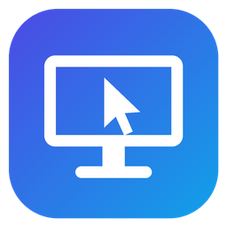

# Remote Desk Viewer



A VNC viewer for **Windows** (Linux and macOS builds come next), written in Rust. It works with the [Remote Desk](../README.md) server in this repository and with standard VNC servers such as TigerVNC and x11vnc. It also supports the account login (Apple Remote Desktop authentication) that macOS Screen Sharing uses.

## Download

Get the latest build from the [Releases page](https://github.com/manideepk90/remote-desktop/releases?q=viewer). Pick either file:

- `remote-desk-viewer-<version>-windows-x64.exe`: run it directly, nothing to install.
- `remote-desk-viewer-<version>-windows-x64.zip`: the same program plus this README and the license.

The program isn't code-signed yet, so Windows SmartScreen may say "Windows protected your PC" the first time. Click **More info → Run anyway**. You can compare the file with `SHA256SUMS.txt` from the release.

## Features

- **Connect by IP address or host name**, with an optional port (`192.168.1.20`, `my-pc:5901`, `[fe80::1]:5900`). As in other VNC viewers, `host:1` means display 1 (port 5901).
- **Username and password.** The username is used by servers that log in with an account: macOS Screen Sharing (Apple Remote Desktop authentication) and VeNCrypt Plain servers such as TigerVNC. Servers that only use a VNC password, such as Remote Desk, ignore it.
- **Passwords stored securely.** If you tick *Remember password*, it goes into **Windows Credential Manager**, encrypted for your Windows account. On macOS it goes into the Keychain, and on Linux into the Secret Service (GNOME Keyring or KWallet). A typed password is saved only after the server accepts it, and it is never written to the app's own files.
- **Saved connections.** Every connection you make is listed on the left. Click one to edit it, double-click to connect, or right-click for more options.
- **Keyboard and mouse:**
  - Keys and modifiers (Ctrl, Shift, Alt, Windows), function keys, arrows and navigation keys.
  - Characters are sent using your local keyboard layout.
  - Mouse buttons (left, middle, right, back), dragging, and vertical and horizontal scrolling.
- **Clipboard.** Text copied on the remote computer lands on your clipboard. Pressing Ctrl+V sends your clipboard to the remote computer before pasting.
- **Display:**
  - *Fit* scales the remote screen to the window; *1:1* shows it at actual size with scrollbars.
  - Full screen (button or **Ctrl+Alt+Enter**). In full screen, move the mouse to the top edge to show the toolbar.
  - Follows remote resolution changes without reconnecting.
- **Ctrl+Alt+Del** button and a **View only** mode.
- **Approval-aware:** while a Remote Desk host is waiting for someone at the desk to approve a new device, the viewer says so instead of looking stuck.

### Protocol support

| | |
|---|---|
| RFB versions | 3.3, 3.7, 3.8 (and Apple's 3.889) |
| Authentication | None, VNC password, Apple Remote Desktop (username + password), VeNCrypt Plain (username + password) |
| Encodings | ZRLE, Hextile, CopyRect, RRE, Raw |
| Pseudo-encodings | Cursor (drawn locally), DesktopSize, ExtendedDesktopSize, DesktopName, LastRect |

## Security

VNC traffic is **not encrypted**. The VNC password check and Apple's login keep the password itself off the wire. VeNCrypt *Plain* sends the username and password as plain text, so only use it on a network you trust. When you're away from your home or office network, connect over a VPN such as [Tailscale](https://tailscale.com) or through an SSH tunnel:

```sh
ssh -L 5900:localhost:5900 you@remote-host     # then connect the viewer to localhost
```

Saved connections live in `%APPDATA%\Remote Desk Viewer\config\connections.json` on Windows. That file holds names, addresses, usernames and view settings. It never contains passwords.

## Known limitations

- TLS-encrypted logins (VeNCrypt TLS/X509, RealVNC's own encryption) aren't supported yet.
- Some layouts type characters with AltGr (for example `@` on a German keyboard). Windows reports AltGr as Ctrl+Alt, so those characters arrive at the remote computer as Ctrl+Alt shortcuts.
- Windows keeps a few shortcuts for itself, such as Alt+Tab, the Windows key and Ctrl+Alt+Del. Use the toolbar button for Ctrl+Alt+Del.

## Building from source

Requirements: Rust 1.88 or newer.

```sh
cd client
cargo run --release           # build and start
cargo test                    # unit tests and end-to-end tests against a scripted server
```

On Windows the build embeds the app icon, which needs the Windows SDK's resource compiler (installed with the Visual Studio Build Tools).

To check a server without opening a window, use the snapshot example. It connects, optionally types some text, and saves the screen as a PPM image:

```sh
RDV_PASSWORD=secret cargo run --example snapshot -- 192.168.1.20:5900 screen.ppm
```

## Releases

Pushing a tag named `viewer-v<version>` (matching `version` in `Cargo.toml`) makes the [Viewer workflow](../.github/workflows/viewer.yml) test and build on Windows and publish a GitHub release. The release notes come from [CHANGELOG.md](CHANGELOG.md).
